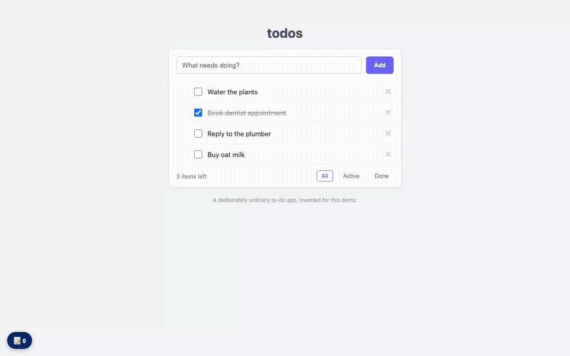
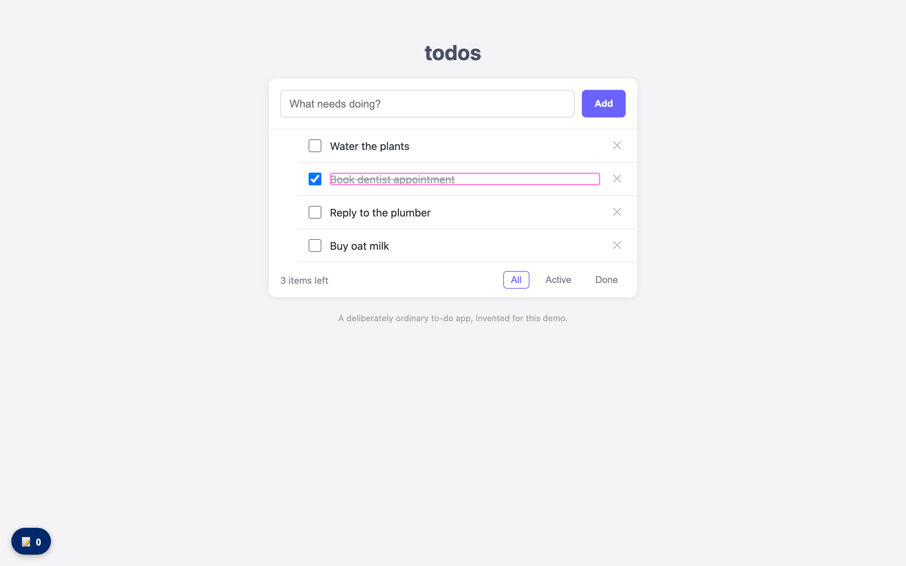
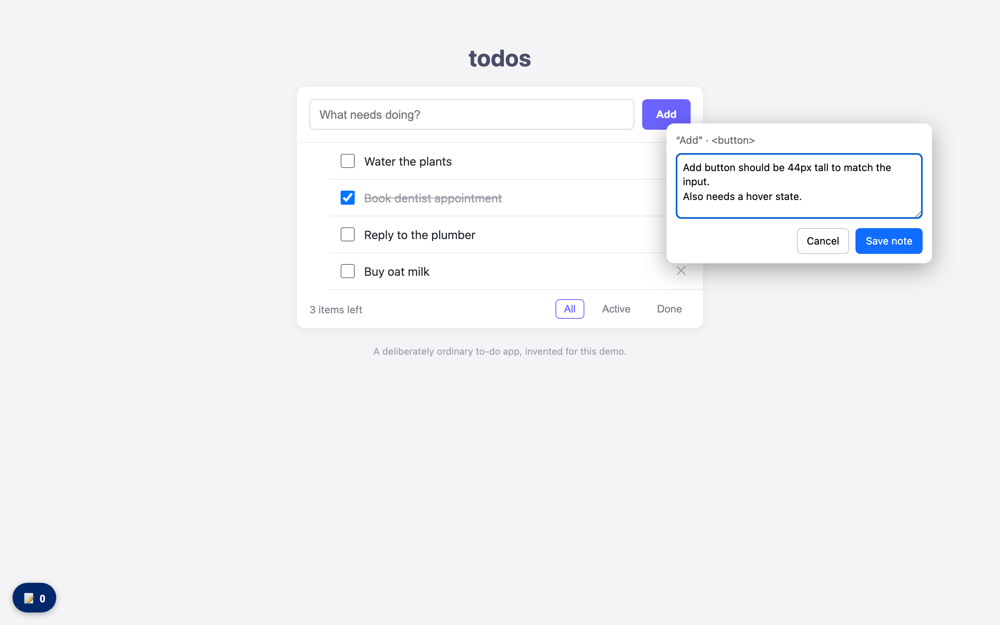
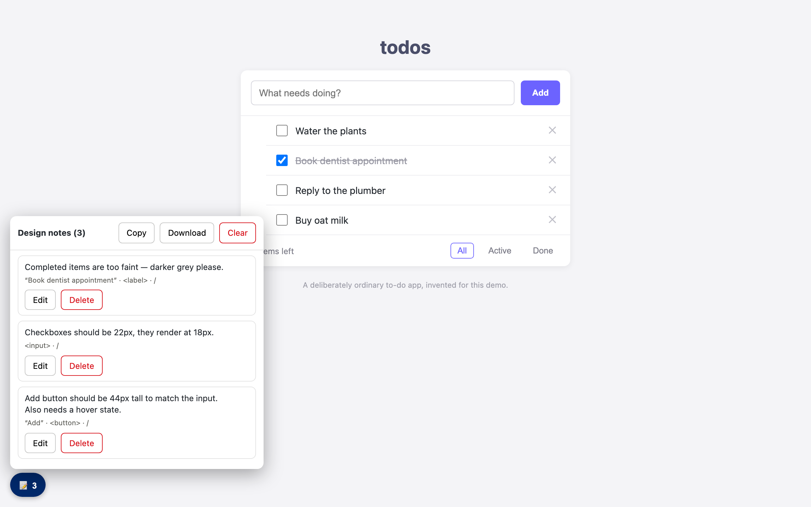

# design-notes

[](https://buymeacoffee.com/willlacf)

Annotate a running web app by clicking on things, then hand the whole batch of feedback to an AI coding agent in one go.

Built for the "this padding is wrong, that font is off, this should be 12px" loop between design review and implementation. Instead of describing each issue in chat one at a time, you Alt+click the element, type what's wrong, and export everything as one JSON file that carries the technical context an agent needs to find and fix each issue — computed styles, the React component chain, and (on dev builds) the exact source file and line.

No build step, no dependencies, no network calls. One vanilla JS file, plus an optional browser extension that loads it for you. Notes stay in your browser's localStorage until you export or clear them. If it saves you review cycles, you can [buy me a coffee](https://buymeacoffee.com/willlacf).



**[Try it live →](https://liywjl.github.io/design-notes-tool/demo/)** — the demo page (a deliberately ordinary to-do app) has the tool pre-loaded: hold Alt (⌥ Option on a Mac) and start clicking.

## Install

**Browser extension (recommended)** — loads the tool on every refresh of the sites you turn it on for. It's this repo's own extension in [`extension/`](extension), not a third-party add-on.

1. Clone or [download](https://github.com/liywjl/design-notes-tool/archive/refs/heads/master.zip) this repo.
2. Load the `extension` folder:
   - **Chrome, Edge, Brave, Arc, Opera:** open `chrome://extensions` (Edge: `edge://extensions`), turn on **Developer mode**, click **Load unpacked**, pick the `extension` folder.
   - **Firefox 128+:** open `about:debugging#/runtime/this-firefox`, click **Load Temporary Add-on**, pick `extension/manifest.json`. Firefox drops unsigned add-ons on restart.
   - **Safari (untested):** `xcrun safari-web-extension-converter extension`, then run the generated Xcode project.
3. Open your app, click the toolbar icon → **Turn on for this site**.

It only asks for access to the sites you turn on, and makes no network requests. Turn a site off from the same popup.

**DevTools snippet** — open DevTools → Sources → Snippets → New snippet → paste [`extension/design-notes.js`](extension/design-notes.js) → run with Cmd/Ctrl+Enter. Re-run after a full page reload. (New to snippets? See the [Chrome DevTools snippets guide](https://developer.chrome.com/docs/devtools/javascript/snippets).)

**Console** — paste the contents of `extension/design-notes.js` into the DevTools console.

**Bookmarklet** — serve or host `extension/design-notes.js` somewhere you trust, then bookmark:

```
javascript:fetch('https://YOUR-HOST/design-notes.js').then(r=>r.text()).then(eval)
```

## Use

**1. Alt+hover** — anything under the cursor gets highlighted:



**2. Alt+click** — a note box opens on the element; write as much as you need (Cmd/Ctrl+Enter saves):



**3. The badge** (bottom-left) opens the manager — edit or delete individual notes, copy or download the batch:



| Action | How |
|---|---|
| Highlight an element | Hold **Alt** (⌥ Option on a Mac) and move the mouse |
| Add a note | **Alt+click** the element, type in the box (multi-line), Save or ⌘ Enter / Ctrl+Enter |
| Add a note without a key | Click the **crosshair** (next to the badge), then the element. Esc cancels |
| Change the key | Badge → **Add notes with** |
| Manage notes | Click the **📝 badge** (bottom-left): edit, delete per note |
| Copy all as JSON | Badge → **Copy** |
| Download all | Badge → **Download** (`design-notes.json`) |
| Start over | Badge → **Clear** |
| Light or dark | Badge → **Auto** / **Light** / **Dark** (click to switch; remembered per site) |

## Trigger key

Alt+click is the default. If Alt clashes with something else, such as a dictation app on ⌥ Option (Wispr Flow) or a Linux window manager that grabs Alt+click, pick another in the manager's **Add notes with** menu. The choice is saved per site in `localStorage` (`design-notes-trigger`).

| | Mac | Windows / Linux |
|---|---|---|
| `alt` (default) | ⌥ Option+click | Alt+click |
| `shift` | ⇧ Shift+click | Shift+click |
| `meta` | ⌘ Command+click | — |
| `ctrl` | — (Control+click is right-click) | Ctrl+click |
| `none` | crosshair button only | crosshair button only |

To set a default before loading the script:

```js
window.designNotesConfig = { trigger: 'shift' }
```

## Theme

The note box and manager follow your system's light or dark mode by default. Click the theme button in the manager to pin it to **Light** or **Dark**; the choice is saved in `localStorage` (`design-notes-theme`). To set a default before loading the script, for example in an app that is always dark:

```js
window.designNotesConfig = { theme: 'dark' }
```

The tool's styles are scoped to its own root, so the page's own button and textarea styles don't leak into it.

## What each note captures

```json
{
  "note": "completed items are too faint — keep the strikethrough but use a darker grey",
  "page": "/",
  "viewport": "1440x900",
  "element": {
    "text": "Book dentist appointment",
    "tag": "label",
    "testId": "todo-item",
    "componentChain": ["label", "TodoItem", "TodoList"],
    "source": "src/components/TodoItem.tsx:18",
    "box": { "x": 214, "y": 313, "w": 342, "h": 21 },
    "styles": { "fontSize": "15px", "color": "rgb(154, 154, 165)", "textDecoration": "line-through" }
  }
}
```

`componentChain` and `source` come from React's dev-build internals (fiber `_debugSource`), so they're richest on a local dev server. On production builds you still get the tag, test id, class names, geometry, and computed styles.

Nothing React-specific is required — on non-React apps you simply get the DOM/CSS context.

## The batch workflow

1. Run your app locally, load the tool. (Or just play with the [live demo](https://liywjl.github.io/design-notes-tool/demo/) — no setup at all.)
2. Walk the UI against your designs; Alt+click everything that looks off.
3. Badge → **Copy** (or **Download** for a `design-notes.json` file).
4. Paste it to your LLM / coding agent with a prompt like:

   > Here is a batch of design feedback captured on the running app. Each note includes the element's
   > computed styles, component chain, and source location. Work through every note and fix them.

   One paste, whole batch — no per-issue back-and-forth.

Each note is self-locating, so the agent can map "this font looks wrong" + `fontFamily: "Times"` + a test id straight to the offending element without any back-and-forth.

## Privacy

Everything stays local: notes live in `localStorage` under the `design-notes` key for the origin you're annotating. Export is a file download or a clipboard copy. The script makes no network requests.

## License

MIT
